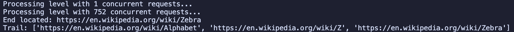

# WikiSpider
A fast, resilient Wikipedia crawler that finds the shortest path between two articles with Breadth First Search.

## Description
WikiSpider is a python-based web crawler that traverses Wikipedia articles using links to find the shortest path between any two connected articles with a Breadth First Search algorithm! It also uses `asyncio` to speed up the program heavily.

### Screenshots


## Getting Started

### Dependencies

* Python 3.14.xx
* BeautifulSoup 4
* HTTPx

### Installing

* To get started, clone the repo:
    * `git clone https://github.com/astrokoala23/wikispider.git`

### Executing program

* Open the repo folder
```
cd wikispider
```
* Run the file
```
python3 main.py
```

## Help

It may be a little slow, but that is because the BFS queue grows expnentially, it will eventually output something.

## License

This project is licensed under the MIT License - see the LICENSE.md file for details